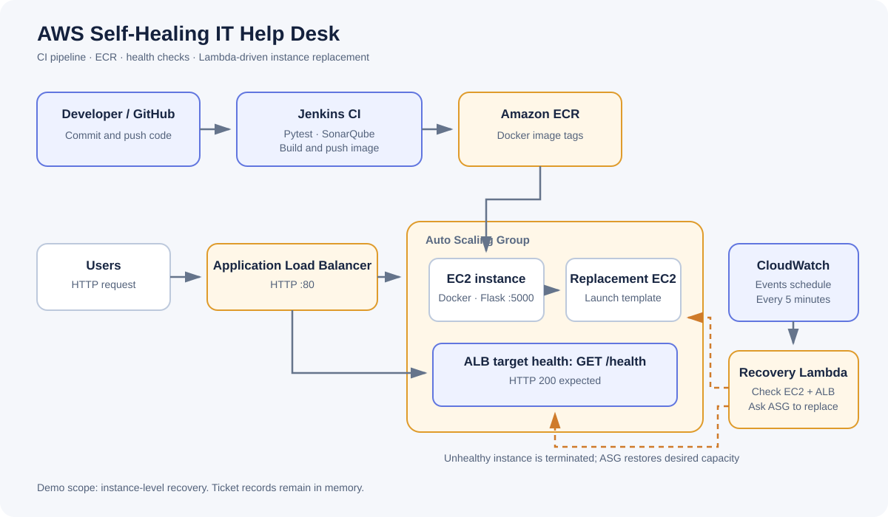

# AWS Self-Healing IT Help Desk

A portfolio project combining a Flask-based IT support ticket portal, Docker packaging, Jenkins CI, SonarQube quality checks, Amazon ECR, and Terraform-managed AWS infrastructure.

The recovery workflow uses a scheduled CloudWatch Events (EventBridge) rule to invoke a Lambda function. Lambda checks the Auto Scaling Group's current EC2 instances and ALB target health, then asks the ASG to replace instances that remain impaired or unhealthy beyond a startup grace period.

> **Scope note:** this project implements instance-level recovery, not application-code remediation. Tickets are held in process memory and are not durable across restarts.

## Project highlights

- Responsive Help Desk dashboard for creating and reviewing support tickets.
- Flask health endpoint: GET /health.
- Automated tests using pytest.
- Jenkins stages for tests, SonarQube analysis, quality gate, Docker build, ECR push, and ASG deployment.
- Terraform-managed VPC, public subnets in two Availability Zones, internet gateway, security groups, IAM roles, ECR, ALB, target group, launch template, and Auto Scaling Group.
- Scheduled Lambda health checks for current ASG instances.
- EC2 system/instance status and ALB target health checks, with a five-minute launch grace period.
- Replacement of unhealthy instances through Auto Scaling without reducing desired capacity.
- Lambda logs in CloudWatch Logs and an architecture diagram.

## Architecture

Editable Mermaid source: [docs/architecture.md](docs/architecture.md).

## Technology stack

| Area | Tools |
|---|---|
| Application | Python, Flask, Jinja templates |
| Container | Docker |
| CI and quality | Jenkins, pytest, SonarQube |
| Image registry | Amazon ECR |
| AWS runtime | EC2, Auto Scaling, Application Load Balancer |
| Recovery | AWS Lambda, CloudWatch Events/EventBridge, CloudWatch Logs |
| Networking and access | VPC, public subnets, security groups, IAM |
| Infrastructure as Code | Terraform |

## Repository structure

~~~text
.
├── app/main.py
├── templates/index.html
├── tests/test_main.py
├── Dockerfile
├── Dockerfile.jenkins
├── Jenkinsfile
├── requirements.txt
├── sonar-project.properties
├── terraform/
│   ├── versions.tf
│   ├── variables.tf
│   ├── networking.tf
│   ├── security.tf
│   ├── iam.tf
│   ├── compute.tf
│   ├── lambda.tf
│   ├── lambda_recovery.py
│   ├── user_data.sh.tftpl
│   ├── outputs.tf
│   └── terraform.tfvars.example
└── docs/
    ├── architecture.md
    ├── architecture.svg
    └── screenshots/
~~~

## Run locally

Requirements: Python 3.10+ and pip.

~~~bash
git clone https://github.com/venkatasaikirannadupuru/aws-self-healing-help-desk.git
cd aws-self-healing-help-desk

python -m venv .venv
# Windows Git Bash:
source .venv/Scripts/activate
# Linux/macOS:
# source .venv/bin/activate

python -m pip install -r requirements.txt
python -m app.main
~~~

Open http://127.0.0.1:5000. Health check: http://127.0.0.1:5000/health.

Run tests:

~~~bash
python -m pytest -v
~~~

Run as a container:

~~~bash
docker build -t helpdesk:local .
docker run --rm -p 5000:5000 helpdesk:local
~~~

## AWS deployment with Terraform

**Cost and security warning:** applying this configuration creates billable resources, including an Application Load Balancer, Lambda invocations/logs, and EC2 capacity. Review the plan and your AWS budget before applying. Use a sandbox account and destroy resources when finished. The demo uses public subnets and HTTP only; do not use it as-is for sensitive production traffic.

### Prerequisites

- AWS CLI configured for the intended account and region.
- Terraform 1.6 or newer.
- Docker and permission to push to Amazon ECR.
- IAM permissions to create the resources in the Terraform plan.

### 1. Bootstrap the infrastructure with zero EC2 instances

Start with zero instances so user data does not try to pull an ECR image before Jenkins publishes it.

~~~bash
cd terraform
cp terraform.tfvars.example terraform.tfvars
# Keep desired_capacity = 0 for the initial bootstrap.
terraform init
terraform fmt -check
terraform validate
terraform plan
~~~

Review the plan, especially the ALB and other billable resources. Apply only after confirming the resources and account:

~~~bash
terraform apply
~~~

This creates the ECR repository, ALB/target group, ASG with zero desired capacity, and Lambda recovery schedule.

### 2. Configure Jenkins and publish an image

The Jenkinsfile expects:
- Jenkins tool named SonarScanner.
- SonarQube server configuration named SonarQube.
- Jenkins credential ID aws-ecr-credentials containing an AWS access key and secret key with least-privilege ECR push permissions.
- Docker, AWS CLI, Python, pip, and pytest available on the Jenkins agent.
- The ECR repository and ASG created by the bootstrap apply.

Run the pipeline. It runs tests and the SonarQube quality gate before building and pushing the build-number tag and latest to ECR. Its deployment stage requests one ASG instance and starts an instance refresh.

### 3. Verify the application and recovery

1. Confirm the ASG desired capacity is one and an EC2 instance is InService.
2. Confirm the target group reports the target healthy.
3. Open the Terraform output helpdesk_url.
4. In a sandbox only, perform a controlled failure test on an application instance.
5. Check Lambda's CloudWatch Logs, ASG activity history, EC2 replacement status, and ALB target health.
6. Verify the replacement becomes healthy and the application URL recovers.

The Lambda runs every five minutes and skips instances younger than five minutes. An older instance is replaced if an EC2 status check is impaired or its ALB target state is unhealthy. The Lambda calls TerminateInstanceInAutoScalingGroup with ShouldDecrementDesiredCapacity = false; the ASG launches a replacement at the configured desired capacity.

Do not claim a recovery test passed until it has actually been run and its AWS evidence captured. A scheduled check can take several minutes to detect and replace an instance. It is not a sub-minute recovery guarantee.

## Screenshots

Place real screenshots in docs/screenshots/. Suggested captures:
- helpdesk-dashboard.png — UI with example ticket data.
- jenkins-pipeline.png — successful pipeline and quality gate.
- lambda-cloudwatch-logs.png — recovery handler logs.
- autoscaling-activity.png — replacement activity history.
- target-group-health.png — target health before and after a test.

Redact account identifiers or sensitive details where appropriate. Screenshots are intentionally not fabricated.

## Current limitations and next improvements

- Tickets are stored in an in-memory Python list; a restart clears them. Add DynamoDB or RDS for persistence.
- The health endpoint confirms the Flask process responds, but does not validate every dependency.
- The recovery Lambda uses a five-minute polling schedule and may take several minutes to detect a failure.
- The demo is HTTP-only. Add HTTPS with ACM and a secure listener before any real deployment.
- Public-subnet instances need outbound internet access for package installation and ECR image pulls. A production design should use private application subnets with appropriate VPC endpoints/NAT and tighter egress rules.
- Recovery terminates an unhealthy instance so the ASG can replace it; it does not fix application bugs in the Docker image.
- IAM policies should be narrowed to the exact ASG and resources for production use.

## Cleanup

When finished, scale the ASG to zero and destroy the stack after reviewing the plan:

~~~bash
terraform destroy
~~~

Review the plan carefully. ECR images or resources outside this Terraform state may need separate cleanup.

## Author

**Venkata Sai Kiran Nadupuru**  
GitHub: [@venkatasaikirannadupuru](https://github.com/venkatasaikirannadupuru)
